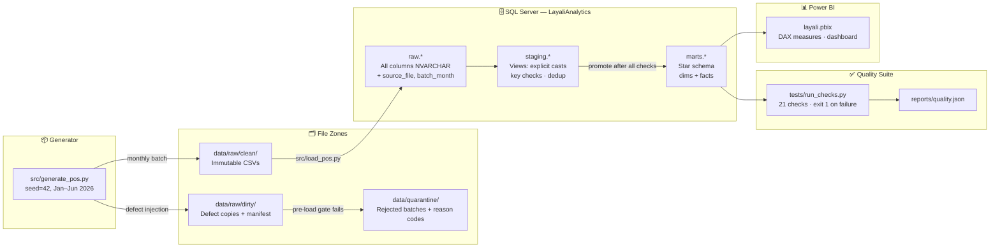
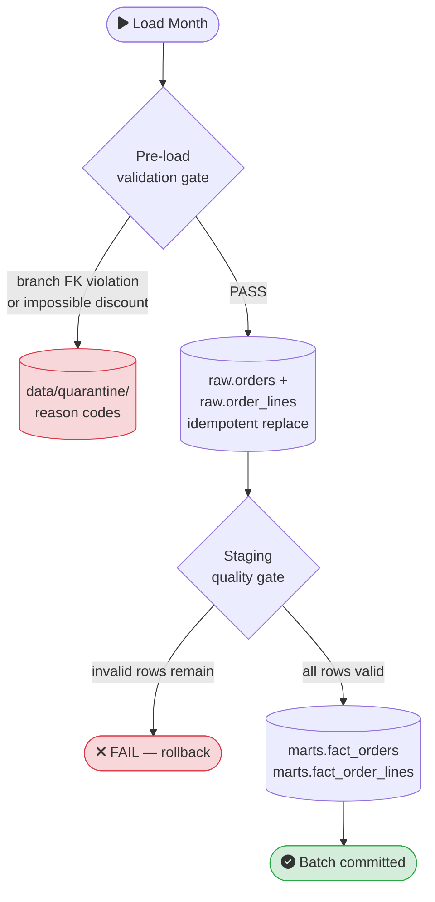
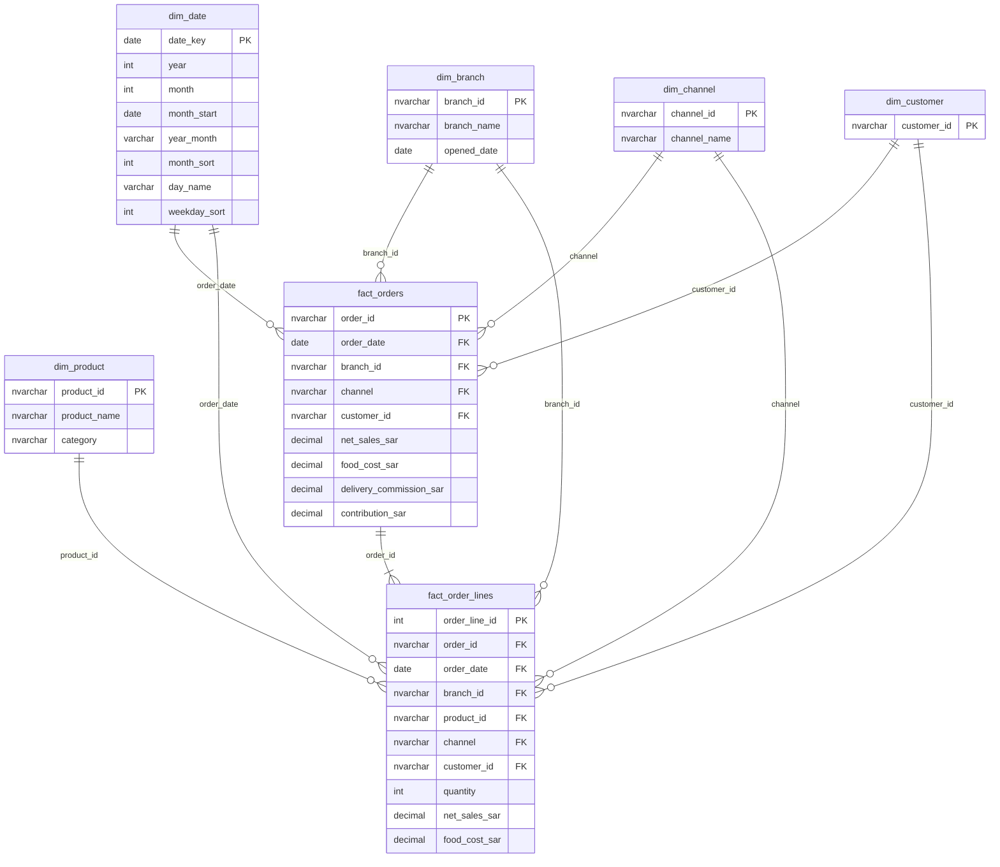

# 🍽️ Layali Analytics

<div align="center">

**End-to-end restaurant analytics pipeline — synthetic POS data · SQL Server data warehouse · Python ETL · Power BI**

[](https://www.python.org/)
[](https://www.microsoft.com/en-us/sql-server)
[](https://powerbi.microsoft.com/)
[](LICENSE)
[](https://github.com/YOUR_USERNAME/layali-analytics/actions)
[](sql/)
[](tests/)

<br/>

*A fictional Saudi multi-branch restaurant case study built as a teaching reference for data engineering, dimensional modelling, and analytics best practices.*

</div>

---

## 📋 Table of Contents

- [Overview](#-overview)
- [Architecture](#-architecture)
- [Data Model](#-data-model)
- [Quick Start](#-quick-start)
- [Project Structure](#-project-structure)
- [Pipeline Stages](#-pipeline-stages)
- [Quality Checks](#-quality-checks)
- [Sample Queries](#-sample-queries)
- [The Planted Story](#-the-planted-story)
- [Contributing](#-contributing)
- [License](#-license)

---

## 🌟 Overview

**Layali Analytics** is a complete, reproducible analytics engineering case study built around a fictional three-branch Saudi restaurant chain. It demonstrates production-grade patterns at every layer of the modern data stack:

| Layer | Technology | Key Pattern |
|-------|-----------|-------------|
| Data Generation | Python · NumPy · Pandas | Fixed seed, reproducible synthetic POS data |
| Ingestion | Python · pyodbc | Streaming CSV loader with pre-load quarantine gate |
| Storage | SQL Server 2022 | Raw / Staging / Marts three-zone architecture |
| Transformation | T-SQL Views | Explicit casts, deduplication, no silent repairs |
| Modelling | Star Schema | Kimball-style facts + conformed dimensions |
| Quality | pytest · pyodbc | 21 automated checks, isolated test schema |
| Visualisation | Power BI Desktop | DirectQuery / Import against marts |

### Restaurant Branches

| Branch ID | Name | City Zone |
|-----------|------|-----------|
| `BR01` | Al Rawdah | Jeddah |
| `BR02` | Al Hamra | Jeddah |
| `BR03` | Obhur | Jeddah North |

> [!NOTE]
> All data is entirely synthetic. No real customers, revenue, or business information is represented. The dataset is designed for teaching analytics engineering patterns.

---

## 🏗️ Architecture



### Load & Promote Flow



---

## 📐 Data Model

### Star Schema — `marts` Schema



### Grain Definitions

| Table | Grain | Row Count (Jan–May 2026) |
|-------|-------|--------------------------|
| `fact_orders` | One **completed** order | 53,587 |
| `fact_order_lines` | One **completed** order line | 147,561 |
| `dim_date` | One calendar day | 181 (Jan 1 – Jun 30) |
| `dim_branch` | One restaurant branch | 3 |
| `dim_product` | One menu item | 25 |
| `dim_channel` | One sales channel | 3 |
| `dim_customer` | One synthetic customer | 5,000 |

> [!IMPORTANT]
> **Do not join `fact_orders` to `fact_order_lines` in Power BI.** They share the same dimensions but have different grains. Use them as independent star schemas. Commission lives **only** on `fact_orders` — it is a single charge per order, not per line.

<details>
<summary>📖 Why an order with three items is still one row in <code>fact_orders</code></summary>

A customer ordering Chicken Mandi + Fattoush + Laban places **one order** (`order_id = ORD-00001`) with **three order lines**. The delivery commission (20% of net sales) is charged once against that order, not per item. Duplicating it onto each line would triple-count it in any `SUM`. Therefore:

- `fact_order_lines`: 3 rows, each with its own product, quantity, net_sales, food_cost — **no commission column**
- `fact_orders`: 1 row, `net_sales_sar = SUM(line net sales)`, `delivery_commission_sar = 20% × net_sales_sar`

This is the **fact-at-the-right-grain** principle from Kimball's dimensional modelling toolkit.

</details>

---

## 🚀 Quick Start

### Prerequisites

| Requirement | Minimum Version | Notes |
|-------------|----------------|-------|
| Python | 3.11+ | 3.14 tested |
| SQL Server | 2019+ | Developer Edition (free) |
| ODBC Driver | 17+ | Driver 18 recommended |
| Power BI Desktop | Latest | Windows only |

### 1 — Clone & Environment

```powershell
git clone https://github.com/YOUR_USERNAME/layali-analytics.git
cd layali-analytics

# Create virtual environment
python -m venv .venv
.\.venv\Scripts\Activate.ps1

# Install pinned dependencies
pip install -r requirements.txt
```

### 2 — Configure Credentials

```powershell
# Copy the template — NEVER commit .env
Copy-Item .env.example .env
notepad .env   # fill in your SQL Server details
```

`.env` values:

```ini
DB_SERVER=localhost          # or .\SQLEXPRESS / server\instance
DB_DATABASE=LayaliAnalytics
DB_TRUSTED_CONNECTION=yes    # Windows Auth (recommended)
# DB_USERNAME=              # SQL Auth (leave blank for Windows Auth)
# DB_PASSWORD=
DB_DRIVER=ODBC Driver 18 for SQL Server
DB_TRUST_SERVER_CERT=yes
```

### 3 — Initialise the Database

```powershell
# Create DB, schemas, staging views, mart tables, dim_date
.\.venv\Scripts\python.exe src/load_pos.py --init-db
```

Expected output:
```
[INFO] Executing sql/01_init_database.sql ... done
[INFO] Executing sql/02_create_raw_tables.sql ... done
[INFO] Executing sql/03_create_staging_views.sql ... done
[INFO] Executing sql/04_create_marts_tables.sql ... done
[INFO] Executing sql/05_populate_dim_date.sql ... done
[INFO] Database initialised successfully.
```

### 4 — Generate Synthetic Data

```powershell
# Generate Jan–May (June held out for refresh demo)
.\.venv\Scripts\python.exe src/generate_pos.py --all

# Or a single month
.\.venv\Scripts\python.exe src/generate_pos.py --month 2026-01
```

### 5 — Load Data into SQL Server

```powershell
# Load all clean months
.\.venv\Scripts\python.exe src/load_pos.py --all

# Or a specific month
.\.venv\Scripts\python.exe src/load_pos.py --month 2026-03
```

### 6 — Run Quality Checks

```powershell
.\.venv\Scripts\python.exe tests/run_checks.py
# Results written to reports/quality.json
# Exit code 0 = all 21 checks passed
```

### 7 — Test the Quarantine Gate

```powershell
# Load a dirty file — should quarantine, never touch marts
.\.venv\Scripts\python.exe src/load_pos.py --test-quarantine
```

### 8 — Refresh Demonstration (June)

```powershell
# Generate June (the held-out month)
.\.venv\Scripts\python.exe src/generate_pos.py --month 2026-06

# Load it into the warehouse
.\.venv\Scripts\python.exe src/load_pos.py --month 2026-06

# Re-run quality checks — should still pass
.\.venv\Scripts\python.exe tests/run_checks.py
```

---

## 📁 Project Structure

```
layali-analytics/
│
├── 📂 data/
│   ├── raw/
│   │   ├── clean/          # Immutable monthly CSVs (gitignored)
│   │   └── dirty/          # Defect copies + manifest.csv (gitignored)
│   └── quarantine/         # Rejected batches + reason JSON (gitignored)
│
├── 📂 docs/
│   ├── data_dictionary.md        # Full schema reference + grain definitions
│   └── generator_assumptions.md  # Planted anomalies + design decisions
│
├── 📂 sql/
│   ├── 01_init_database.sql      # DB creation + schema setup
│   ├── 02_create_raw_tables.sql  # Raw zone tables (all NVARCHAR)
│   ├── 03_create_staging_views.sql  # Staging views: casts, dedup, FK checks
│   ├── 04_create_marts_tables.sql   # Star schema: dims + facts
│   ├── 05_populate_dim_date.sql  # Calendar spine Jan–Jun 2026
│   └── 06_sample_analytical_queries.sql  # 10 business queries
│
├── 📂 src/
│   ├── generate_pos.py     # Synthetic POS data generator (seed=42)
│   ├── load_pos.py         # ETL loader: validate → raw → staging → marts
│   └── db.py               # pyodbc connection factory + script executor
│
├── 📂 tests/
│   ├── run_checks.py       # 21 data quality assertions (exit 1 on failure)
│   └── test_pos_generator.py  # pytest unit tests for the generator
│
├── 📂 powerbi/             # Power BI Desktop files (future)
├── 📂 reports/
│   └── quality.json        # Latest check run results
│
├── 📂 .github/
│   ├── workflows/
│   │   └── quality_checks.yml   # CI: run checks on every push
│   ├── ISSUE_TEMPLATE/
│   │   ├── bug_report.md
│   │   └── feature_request.md
│   └── pull_request_template.md
│
├── .env.example            # Credential template (safe to commit)
├── .gitignore
├── requirements.txt        # Pinned Python dependencies
├── CHANGELOG.md
├── CONTRIBUTING.md
├── CODE_OF_CONDUCT.md
└── LICENSE                 # MIT
```

---

## 🔧 Pipeline Stages

<details>
<summary><strong>Stage 1 — Data Generation</strong> (<code>src/generate_pos.py</code>)</summary>

Generates reproducible synthetic restaurant POS data:

- **Fixed global seed** `42` + per-day seeds → identical output on every run
- **5 months** of data (Jan–May 2026); June held out for refresh demo
- **25 menu items** across 5 categories (Mains, Grills, Mezze, Beverages, Desserts)
- **5,000 synthetic customer IDs**; 25% of orders are anonymous (`customer_id = NULL`)
- **Day-of-week weighting**: Friday 1.45×, Saturday 1.30×, Sunday–Monday base
- **Time-of-day distribution**: Lunch 35%, Afternoon 10%, Dinner 55%
- **1–5 lines per order** with mixed baskets
- **Commission**: 20% of net order sales for delivery orders only

Outputs:
- `data/raw/clean/orders_YYYY_MM.csv` — one row per order
- `data/raw/clean/order_lines_YYYY_MM.csv` — one row per line
- `data/raw/clean/branches.csv`, `products.csv`, `customers.csv` — master tables
- `data/raw/dirty/` — defect-injected copies with `manifest.csv`

</details>

<details>
<summary><strong>Stage 2 — ETL Load</strong> (<code>src/load_pos.py</code>)</summary>

Python loader using `pyodbc` and streaming CSV reads (no pandas in-memory bulk):

**Pre-load validation gate** (before any DB writes):
- Branch FK check: rejects rows with unknown `branch_id` values
- Discount integrity: rejects `discount_sar > quantity × unit_price_sar` or `discount_sar < 0`
- Violations written to `data/quarantine/` with JSON reason codes
- If violations found → abort, marts remain unchanged

**Raw zone load** (idempotent):
```sql
DELETE FROM raw.orders WHERE batch_month = '2026-01'
-- then INSERT all rows from CSV
```

**Staging quality gate** (SQL-side):
- Verifies no invalid rows remain after casting
- Checks FK integrity against dim tables
- Checks discount bounds
- If staging gate fails → rollback, alert user

**Marts promotion** (after all gates pass):
- `fact_orders` populated from aggregated staging subquery
- `fact_order_lines` populated with order-level dimension keys copied from orders
- Cancelled orders never inserted (filtered in staging views)

</details>

<details>
<summary><strong>Stage 3 — Staging Views</strong> (<code>sql/03_create_staging_views.sql</code>)</summary>

Staging views explicitly cast every column from NVARCHAR raw storage:

```sql
-- Example from staging.vw_order_lines
CAST(l.[order_line_id]              AS INT)           AS order_line_id,
CAST(l.[quantity]                   AS INT)           AS quantity,
CAST(l.[unit_price_sar]             AS DECIMAL(10,2)) AS unit_price_sar,
CAST(l.[discount_sar]               AS DECIMAL(10,2)) AS discount_sar,
-- Validation flags (never silently repaired)
CASE WHEN b.[branch_id] IS NOT NULL THEN 1 ELSE 0 END  AS is_valid_branch,
CASE WHEN CAST(l.[discount_sar] AS DECIMAL(10,2)) >= 0
      AND CAST(l.[discount_sar] AS DECIMAL(10,2))
          <= CAST(l.[quantity] AS INT)
           * CAST(l.[unit_price_sar] AS DECIMAL(10,2))
     THEN 1 ELSE 0 END                                  AS is_valid_discount
```

Deduplication is deterministic (exact duplicate source rows only):
```sql
ROW_NUMBER() OVER (
    PARTITION BY batch_month, order_line_id
    ORDER BY loaded_at ASC
) = 1
```

</details>

<details>
<summary><strong>Stage 4 — Marts (Star Schema)</strong> (<code>sql/04_create_marts_tables.sql</code>)</summary>

| Table | Grain | Key design decision |
|-------|-------|---------------------|
| `dim_date` | Calendar day | PK is `DATE` type (not surrogate INT) |
| `dim_branch` | Restaurant branch | Natural key `branch_id` as PK |
| `dim_product` | Menu item | Natural key `product_id` as PK |
| `dim_channel` | Sales channel | 3 rows: dine-in, takeaway, delivery |
| `dim_customer` | Synthetic customer | NULL FK allowed in facts; no "unknown" surrogate |
| `fact_orders` | Completed order | Net sales = SUM(line net sales) |
| `fact_order_lines` | Completed order line | No commission column |

**Contribution margin identity** (checked automatically):
```
contribution_sar = net_sales_sar - food_cost_sar - delivery_commission_sar
```

</details>

---

## ✅ Quality Checks

`tests/run_checks.py` runs **21 automated checks** against the marts schema. Results are written to `reports/quality.json`.

| # | Check | Type |
|---|-------|------|
| 1 | Unique non-null order keys | Uniqueness |
| 2 | Unique non-null line keys | Uniqueness |
| 3 | FK: orders → dim_branch | Referential Integrity |
| 4 | FK: lines → dim_product | Referential Integrity |
| 5 | FK: lines → fact_orders | Referential Integrity |
| 6 | FK: orders → dim_date | Referential Integrity |
| 7 | Positive integer quantity | Domain |
| 8 | `0 ≤ discount ≤ qty × unit_price` | Domain |
| 9 | Non-negative cost and commission | Domain |
| 10 | Dates within requested month range | Range |
| 11 | Exactly 3 branch IDs | Completeness |
| 12 | Customer IDs valid when not NULL | Domain |
| 13 | Cancelled orders absent from facts | Business Rule |
| 14 | Sum of line revenue = order revenue (± SAR 0.01) | Reconciliation |
| 15 | Individual order-line reconciliation | Reconciliation |
| 16 | Contribution margin identity | Business Rule |
| 17 | Commissions only on delivery orders | Business Rule |
| 18 | Re-run batch idempotency | Idempotency |
| 19 | Three-line fixture: commission not duplicated | Business Rule |
| 20 | Dirty fixture rejected by validation gate | Quarantine |
| 21 | Production marts unchanged after dirty rejection | Isolation |

> [!TIP]
> Run `python tests/run_checks.py` after every load. CI runs these automatically on every push to `main`.

---

## 🔍 Sample Queries

<details>
<summary>Monthly Revenue & Contribution by Branch</summary>

```sql
SELECT
    d.[year_month],
    b.[branch_name],
    SUM(fo.[net_sales_sar])            AS net_sales_sar,
    SUM(fo.[food_cost_sar])            AS food_cost_sar,
    SUM(fo.[delivery_commission_sar])  AS commission_sar,
    SUM(fo.[contribution_sar])         AS contribution_sar,
    CAST(
        100.0 * SUM(fo.[contribution_sar])
              / NULLIF(SUM(fo.[net_sales_sar]), 0)
        AS DECIMAL(5,2))               AS contribution_pct
FROM  [marts].[fact_orders]  fo
JOIN  [marts].[dim_date]     d  ON fo.[order_date]  = d.[date_key]
JOIN  [marts].[dim_branch]   b  ON fo.[branch_id]   = b.[branch_id]
GROUP BY d.[year_month], d.[month_sort], b.[branch_name]
ORDER BY d.[month_sort], b.[branch_name];
```

</details>

<details>
<summary>Top 10 Products by Net Sales (All Time)</summary>

```sql
SELECT TOP 10
    p.[product_name],
    p.[category],
    SUM(ol.[quantity])       AS total_qty,
    SUM(ol.[net_sales_sar])  AS net_sales_sar,
    SUM(ol.[food_cost_sar])  AS food_cost_sar
FROM  [marts].[fact_order_lines]  ol
JOIN  [marts].[dim_product]       p  ON ol.[product_id] = p.[product_id]
GROUP BY p.[product_name], p.[category]
ORDER BY net_sales_sar DESC;
```

</details>

<details>
<summary>Channel Mix Shift — Obhur Anomaly Detection</summary>

```sql
SELECT
    d.[year_month],
    b.[branch_name],
    fo.[channel],
    COUNT(*)                 AS order_count,
    CAST(
        100.0 * COUNT(*)
              / SUM(COUNT(*)) OVER (
                    PARTITION BY d.[year_month], b.[branch_name]
                )
        AS DECIMAL(5,1))     AS channel_pct
FROM  [marts].[fact_orders]  fo
JOIN  [marts].[dim_date]     d  ON fo.[order_date] = d.[date_key]
JOIN  [marts].[dim_branch]   b  ON fo.[branch_id]  = b.[branch_id]
GROUP BY d.[year_month], d.[month_sort], b.[branch_name], fo.[channel]
ORDER BY d.[month_sort], b.[branch_name], fo.[channel];
```

</details>

<details>
<summary>Delivery Commission as % of Net Sales</summary>

```sql
SELECT
    d.[year_month],
    SUM(fo.[net_sales_sar])            AS net_sales_sar,
    SUM(fo.[delivery_commission_sar])  AS commission_sar,
    CAST(
        100.0 * SUM(fo.[delivery_commission_sar])
              / NULLIF(SUM(fo.[net_sales_sar]), 0)
        AS DECIMAL(5,2))               AS commission_pct
FROM  [marts].[fact_orders]  fo
JOIN  [marts].[dim_date]     d  ON fo.[order_date] = d.[date_key]
GROUP BY d.[year_month], d.[month_sort]
ORDER BY d.[month_sort];
```

</details>

For all 10 sample queries, see [`sql/06_sample_analytical_queries.sql`](sql/06_sample_analytical_queries.sql).

---

## 🕵️ The Planted Story

This dataset contains several **engineered anomalies** designed for analysis teaching:

| Signal | What to look for | Location |
|--------|-----------------|----------|
| 📉 Volume dip | Obhur orders drop ~20% from April onward | `fact_orders` by branch + month |
| 🛵 Delivery surge | Obhur delivery share jumps from ~24% → ~56% in April | Channel mix by branch |
| 💸 Commission pressure | Delivery commission % rises as delivery mix shifts | `delivery_commission_sar / net_sales_sar` |
| 📅 Weekend peaks | Friday 1.45× and Saturday 1.30× order counts | Day-of-week analysis |
| 🌙 Evening dominance | 55% of orders between 18:00–22:00 | Hour-of-day distribution |

> [!NOTE]
> These are **modelling assumptions, not business findings**. See [`docs/generator_assumptions.md`](docs/generator_assumptions.md) for the full list of planted parameters.

---

## 🤝 Contributing

We welcome contributions! Please read [`CONTRIBUTING.md`](CONTRIBUTING.md) first.

**Before submitting a PR:**
1. Run `python tests/run_checks.py` — all 21 checks must pass
2. Add/update docstrings for any new Python functions
3. Write T-SQL only (no PostgreSQL syntax)
4. Money columns must use `DECIMAL(12,2)` — never `FLOAT`
5. Never commit `.env` or raw data CSVs

---

## 📄 License

This project is licensed under the **MIT License** — see the [LICENSE](LICENSE) file for details.

---

<div align="center">

Built with ❤️ as a data engineering teaching reference · Saudi restaurant case study

*All branches, customers, and revenue figures are entirely fictional.*

</div>
